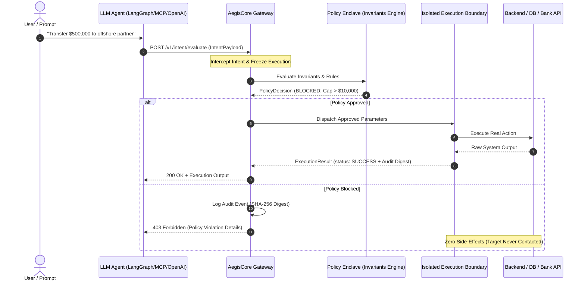

# AegisCore Architecture Specification
## Deterministic Agent Governance Gateway & Zero-Trust Policy Enclave

---

## 1. Executive Overview

**AegisCore** is an open-source, deterministic agent governance gateway designed to eliminate prompt-injection hazards, rogue tool invocations, and unauthorized state mutations produced by Autonomous AI Agents and Large Language Models (LLMs).

Standard AI agent architectures couple model intent directly to tool execution—delegating raw API keys and socket access directly to the LLM runtime. Under adversarial jailbreaks, context drift, or probabilistic hallucination, agents can trigger irreversible data drops, unauthorized financial transfers, or exfiltration.

AegisCore enforces **Strict Intent-Execution Decoupling**:
1. Agents possess zero direct access to backend systems, databases, or third-party APIs.
2. Agents only produce an **Intent Proposal**.
3. AegisCore intercepts the intent at the gateway perimeter, evaluates it against deterministic invariants and policy matrices in a policy enclave, and only dispatches the call within an isolated execution boundary if explicitly approved.

---

## 2. Intent-Execution Decoupling Flow



---

## 3. Data Contracts

AegisCore formalizes agent governance through three canonical, strictly typed data contracts.

### 3.1 `IntentPayload`
The declarative intent submitted by the agent or extracted from the proxy stream.

```typescript
export interface IntentPayload {
  /** Unique identifier for this discrete action proposal */
  intentId: string;
  
  /** ISO-8601 timestamp generated at gateway ingestion */
  timestamp: string;
  
  /** Provenance and identity metadata of the calling agent */
  agent: {
    agentId: string;
    role: string;
    tenantId?: string;
    sessionId: string;
    callerPrincipal?: string;
    riskTier?: 'LOW' | 'MEDIUM' | 'HIGH' | 'CRITICAL';
  };
  
  /** Target tool or action being requested */
  tool: string;
  
  /** Category classification */
  actionCategory?: 'READ' | 'WRITE' | 'EXECUTE' | 'TRANSFER' | 'DELETE' | 'ADMIN';
  
  /** Proposed parameters passed to the tool */
  parameters: Record<string, unknown>;
  
  /** Optional caller metadata or LLM context */
  metadata?: Record<string, unknown>;
  
  /** Client-provided idempotency token */
  idempotencyKey?: string;
}
```

### 3.2 `PolicyDecision`
The deterministic verdict rendered by the policy engine.

```typescript
export type GovernanceDecisionStatus = 'APPROVED' | 'BLOCKED' | 'REQUIRES_ESCALATION';

export interface PolicyDecision {
  /** Unique identifier for the audit trail */
  decisionId: string;
  
  /** Correlated intent ID */
  intentId: string;
  
  /** ISO-8601 evaluation timestamp */
  timestamp: string;
  
  /** Deterministic verdict */
  status: GovernanceDecisionStatus;
  
  /** Human-readable explanation of verdict */
  reason: string;
  
  /** Identifiers of policies/rules that matched */
  matchedRules: string[];
  
  /** Detailed list of violated invariant rules (if any) */
  violatedInvariants?: string[];
  
  /** Optional parameter redaction or scrubbing applied by policy */
  sanitizedParameters?: Record<string, unknown>;
  
  /** Binary flag authorizing dispatch into execution boundary */
  executionAllowed: boolean;
}
```

### 3.3 `ExecutionResult`
The output of the isolated execution boundary.

```typescript
export type ExecutionStatus = 'SUCCESS' | 'FAILURE' | 'BLOCKED' | 'SIMULATED';

export interface ExecutionResult {
  /** Unique execution cycle identifier */
  executionId: string;
  
  /** Correlated intent ID */
  intentId: string;
  
  /** Correlated decision ID */
  decisionId: string;
  
  /** Execution status */
  status: ExecutionStatus;
  
  /** Timestamp */
  timestamp: string;
  
  /** Wall-clock execution time in milliseconds */
  durationMs: number;
  
  /** Tool execution response payload (null if blocked) */
  output?: unknown;
  
  /** Failure or security error details */
  error?: {
    code: string;
    message: string;
    details?: unknown;
  };
  
  /** SHA-256 cryptographic digest binding intent + decision + execution */
  auditDigest: string;
}
```

---

## 4. Policy Definition Specification

Policies are declarative JSON / Rego-compatible specifications composed of prioritized rules:

```json
{
  "version": "1.0.0",
  "policyNamespace": "fintech.banking.guardrails",
  "defaultEffect": "DENY",
  "rules": [
    {
      "id": "BNK-001-DENY-HIGH-VALUE-TRANSFER",
      "name": "Prohibit Transfers Exceeding $10,000 Autonomous Cap",
      "targetTools": ["transfer_funds", "wire_money"],
      "effect": "DENY",
      "priority": 1000,
      "conditions": [
        {
          "field": "parameters.amount",
          "operator": "GREATER_THAN",
          "value": 10000,
          "description": "Transfer amount violates autonomous ceiling invariant ($10,000.00 USD)"
        }
      ]
    }
  ]
}
```

### Supported Invariant Operators
- `EQUALS` / `NOT_EQUALS`
- `GREATER_THAN` / `LESS_THAN` / `LESS_THAN_OR_EQUAL`
- `IN` / `NOT_IN`
- `MATCHES_REGEX`
- `CONTAINS`

---

## 5. Security & Isolation Invariants

1. **Deny-by-Default (Zero-Trust Perimeter):** If an intent matches zero rules, AegisCore strictly returns `BLOCKED`.
2. **Deny-Overrides Precedence:** Any matching `DENY` rule immediately terminates evaluation and suppresses downstream execution.
3. **No Direct Network Access for Agents:** Agents only communicate with the AegisCore reverse proxy. Target credentials (API tokens, private keys, database connection strings) are stored solely inside the isolated execution boundary.
4. **Cryptographic Audit Digest:** Every intent, decision, and result tuple produces a canonical SHA-256 hash `H(intentId || decisionId || output)` for tamper-evident provenance.
