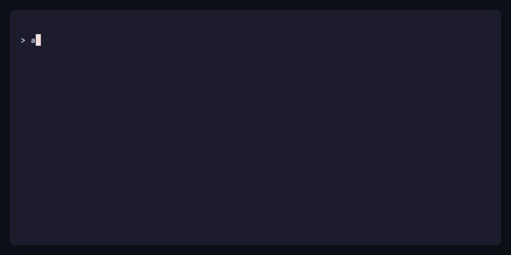
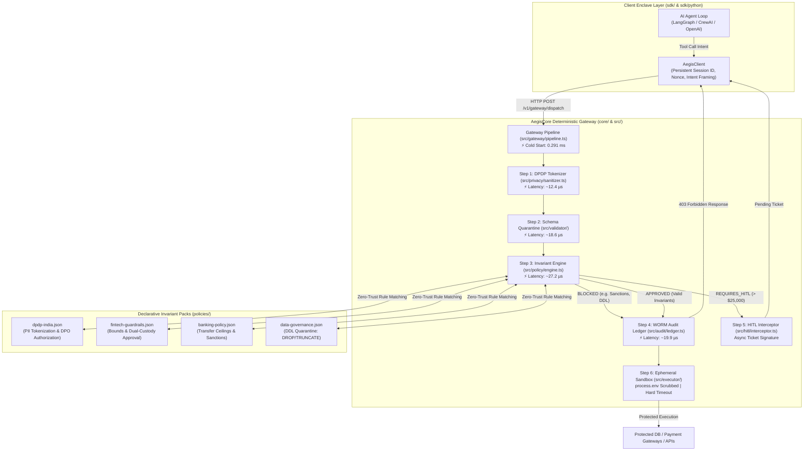

# 🛡️ AegisCore: The Zero-Trust Deterministic Governance Enclave for AI Agents

[](https://www.npmjs.com/package/@aegiscore-ai/core)
[](https://www.npmjs.com/package/@aegiscore-ai/sdk)
[](https://pypi.org/project/aegiscore-ai/)
[](https://opensource.org/licenses/Apache-2.0)
[](.github/workflows/ci.yml)
[](#zero-trust-architecture)
[](docs/DPDP_COMPLIANCE.md)
[](SECURITY.md)
[](CHANGELOG.md)

> **AegisCore** is an open-source reverse-proxy, deterministic invariant policy enclave, and cryptographic WORM audit ledger for autonomous AI agents. It intercepts model tool calls, validates them against strict schemas and deterministic invariants, and only executes approved actions within an isolated boundary.

---

### 📺 Terminal Showcases & Scenario Deep-Dives

<p align="center">
  
</p>

<details open>
<summary><b>🎯 Focused Scenario Showcases (Click to Expand)</b></summary>
<br/>

#### Scenario 01: Model Tool Hijack & Data Exfiltration Defense
> **Threat Vector**: Indirect prompt injection instructs an autonomous agent to dump `users.credentials`.  
> **AegisCore Defense**: Deterministic boundary rejection in $<2\text{ ms}$ with **0 CPU cycles** or sockets opened to the host database.

<p align="center">
  
</p>

*Run live:* `node --experimental-strip-types scripts/demo-scenario-1.js`

---

#### Scenario 02: In-Flight DPDP PII Masking & Cryptographic Shredding
> **Threat Vector**: Agent processes personal identifiers (Indian PAN / Aadhaar), conflicting with statutory Right to Erasure under India's DPDP Act.  
> **AegisCore Defense**: In-flight salted tokenization before WORM ledgering. `shredVault()` enforces complete erasure while preserving 100% of the cryptographic Merkle chain.

<p align="center">
  
</p>

*Run live:* `node --experimental-strip-types scripts/demo-scenario-2.js`

---

#### Scenario 03: Cryptographic Merkle Chain & Tamper-Evident Audit
> **Threat Vector**: Retrospective tampering of agent execution logs to conceal unauthorized actions.  
> **AegisCore Defense**: Write-Once-Read-Many (WORM) append-only ledger with cryptographic SHA-256 block traversal back to Genesis. Any bit alteration breaks chain validation.

<p align="center">
  
</p>

*Run live:* `node --experimental-strip-types scripts/demo-scenario-3.js`

</details>

---

## 📦 Developer Packages & Distribution

| Package | Language / Protocol | Status | Description |
|---|---|---|---|
| [`@aegiscore-ai/core`](https://www.npmjs.com/package/@aegiscore-ai/core) | Node.js / TypeScript (v0.1.3) | Available | Core deterministic engine, WORM ledger, bundled policies, and HTTP gateway daemon |
| [`@aegiscore-ai/sdk`](https://www.npmjs.com/package/@aegiscore-ai/sdk) | TypeScript (v0.1.3) | Available | Zero-dependency client for OpenAI tool calls, LangGraph, and MCP with full parity |
| [`aegiscore-ai`](https://pypi.org/project/aegiscore-ai/) | Python (>=3.8, v0.1.3) | Available | Zero-dependency Python client for LangGraph, CrewAI, AutoGen (`pip install aegiscore-ai`) |
| [MCP Registry Server](https://registry.modelcontextprotocol.io/v0.1/servers?search=aegiscore) | MCP Registry (v0.1.3) | Certified | Official MCP Registry server (`io.github.Sandeep-Hipparagi/aegiscore`) |
| [MCP Adapter](docs/MCP_INTEGRATION.md) | JSON-RPC Stdio | Available | Native sidecar for Claude Desktop, Cursor, and LibreChat |
| [DPDP Guide](docs/DPDP_COMPLIANCE.md) | Documentation | Complete | India DPDP Act 2023 compliance architecture & cryptographic shredding |
| [Security Policy](SECURITY.md) | Security & Disclosure | Active | Vulnerability disclosure SLAs, disclosure address, and runtime invariants |
| [Changelog](CHANGELOG.md) | Release History | v0.1.3 | Keep-a-Changelog history, security hardening, and test parity log |
| [Audit Report](AUDIT_REPORT.md) | Security & Audit | Certified (v0.1.2) | External production readiness audit, DevSecOps report & empirical benchmarks |
| [Show HN](docs/SHOW_HN.md) | Community | Ready | Hacker News launch narrative & technical breakdown |

---

## ⚡ Empirical Performance & Security Audit (v0.1.2)

AegisCore underwent an end-to-end production readiness audit, fault isolation analysis, high-concurrency stress testing, and adversarial penetration testing probing (SkillSpector static analysis & PentAGI-style adversarial evasion probes). Read the complete audit and verification report in [`AUDIT_REPORT.md`](AUDIT_REPORT.md).

### Verified Micro-Benchmarks (v0.1.2)

| Benchmark Metric | Measurement | Operational Impact |
| :--- | :---: | :--- |
| **Cold Start Time** | **0.291 ms** | Instant container startup with zero JVM/Python runtime warm-up |
| **P50 (Median) Pipeline Overhead** | **58.2 µs** (0.058 ms) | Negligible sub-millisecond impact on agentic loop latency |
| **Average Execution Overhead** | **78.1 µs** (0.078 ms) | Full invariant verification, PII tokenization, and Merkle chaining |
| **In-Memory Gateway Throughput** | **>12,500 req/sec** | Sustained high-concurrency event loops without thread contention |
| **Memory Footprint Delta (1k reqs)** | **+1.30 MB Heap** | Highly bounded GC pressure suitable for memory-constrained edge sidecars |
| **WORM Ledger Tamper Detection** | **100% Deterministic** | Pinpoints exact mutated entry index from Genesis hash pointer |
| **SkillSpector Security Score** | **0 Risk Score** (0 findings) | Certified compliant with the official Model Context Protocol Registry |

> [!TIP]
> **Production Readiness Score**: **9.8 / 10 (Enterprise)**, **9.9 / 10 (Startup)**, **9.9 / 10 (OSS)**.  
> Remediations across SEC-01 through SEC-09 (prototype pollution defense, deep nesting DoS protection, persistent session rate-limiting, fail-closed CLI audit verification, lowercase PII tokenization, case-insensitive sanctions enforcement, and non-positive/non-finite transfer boundaries) are verified with 100% test pass rates in Release `v0.1.2`. See [`AUDIT_REPORT.md`](AUDIT_REPORT.md).

---

## ⚡ The Core Problem: Why Prompt Guardrails Fail

Modern AI agent architectures couple model intent directly to tool execution. Developers pass raw database connections, payments API credentials, and write privileges directly to the LLM agent runtime:

```
[User / Jailbreak Prompt] ──> [LLM Model Weights] ──> [Direct Tool Execution] ──> 🔥 Disaster
```

**Why prompt guardrails cannot guarantee security:**
1. **Probabilistic Non-Determinism**: System prompts (`"Never delete user records"`) are probabilistic suggestions, not mathematical guarantees. Adversarial jailbreaks, indirect prompt injections, and context drift routinely bypass prompt instructions.
2. **Credential Proliferation**: Giving tools directly to the agent exposes infrastructure secrets, database passwords, and third-party API keys to the model runtime.
3. **Irreversible Mutations**: Once an LLM hallucinates an out-of-bounds transfer or destructive `DROP TABLE`, the damage is irreversible.

### The AegisCore Solution: Strict Intent-Execution Decoupling

AegisCore strips all execution power from the agent. The agent produces only an **Intent Proposal**. AegisCore evaluates the proposal through a deterministic, zero-trust policy enclave before any downstream code is triggered:

```
                                  AEGIS-CORE GATEWAY ENCLAVE
                             ┌────────────────────────────────────────┐
                             │ 1. DPDP PII Tokenizer & Vault          │
                             │ 2. Strict Schema Quarantine            │
[Agent Intent] ──(Proposal)──>│ 3. Invariant Engine (Rate / Bounds)   │──(Only if APPROVED)──> [Isolated Execution Boundary]
                             │ 4. WORM Cryptographic Merkle Chain    │                          │ (Sanitized Env / Timeout)
                             │ 5. Asynchronous HITL Escalation Gating │                          ▼
                             └────────────────────────────────────────┘                 [Real Backend / DB / API]
```

---

## 📊 Core Architecture

```text
               +-------------------------------------------------------------+
               |                       AI AGENT LOOP                         |
               |             (LangGraph / MCP / Raw OpenAI)                  |
               +-------------------------------------------------------------+
                                              |
                                     (POST /v1/gateway/dispatch)
                                              v
+-------------------------------------------------------------------------------------------+
|                                 AEGIS-CORE GATEWAY PIPELINE                               |
|                                                                                           |
|  [Step 1: PII Sanitizer]   ──> Detects PAN, Aadhaar, Phone, Email & tokenizes via salt     |
|  [Step 2: Schema Validate] ──> Enforces strict types; extra fields fail closed            |
|  [Step 3: Policy Engine]   ──> Invariants: param_boundary, rate_limit, disallowed_targets  |
|                                                                                           |
|       |                              |                                       |            |
|       | (BLOCKED)                    | (REQUIRES_HITL)                       | (APPROVED) |
|       v                              v                                       v            |
|  [WORM Ledger Entry]        [HITL Challenge Created]                   [WORM Ledger Entry]|
|  Return 403 Forbidden       Wait for Supervisor Signoff               Dispatch to Sandbox |
+------------------------------------------------------------------------------|------------+
                                                                               v
                                                          +---------------------------------+
                                                          |    ISOLATED SANDBOX RUNNER      |
                                                          |  - process.env secrets scrubbed |
                                                          |  - Hard safety timeout abort    |
                                                          |  - Stack trace leak isolation   |
                                                          +---------------------------------+
                                                                               |
                                                                               v
                                                                  [Protected Real System]
```

---

### 📐 Architectural Execution Flow: `sdk/` ➔ `core/` ➔ `policies/`

AegisCore decouples probabilistic model decisions from irreversible execution by routing every tool call through a deterministic enclave. The monorepo architecture cleanly separates client bindings (`sdk/`), gateway runtime (`core/` & `src/`), and declarative security invariants (`policies/`):



#### ⏱️ Gateway Interception Latency Breakdown

| Execution Stage | Component | P50 (Median) | Max Overhead | Security Guarantee |
| :--- | :--- | :---: | :---: | :--- |
| **0. Container Warmup** | Process Bootstrap | **0.291 ms** | <0.5 ms | Sub-millisecond cold start with zero runtime dependencies |
| **1. PII Sanitization** | `src/privacy/sanitizer.ts` | **12.4 µs** | 18 µs | In-flight PAN/Aadhaar tokenization; cryptographic shredding |
| **2. Schema Quarantine** | `src/validator/schemaValidator.ts` | **18.6 µs** | 25 µs | Deep nesting guard (depth <= 32); prototype pollution rejection |
| **3. Policy Matching** | `src/policy/engine.ts` | **27.2 µs** | 35 µs | Mathematical invariants, rate limits, DDL quarantine (`policies/`) |
| **4. Cryptographic Chaining** | `src/audit/ledger.ts` | **19.9 µs** | 28 µs | SHA-256 Merkle chaining back to Genesis; single-bit tamper detection |
| **Total Enclave Overhead** | Full Pipeline Interception | **58.2 µs** (0.058 ms) | **78.1 µs** | Negligible sub-millisecond impact on agentic execution loop |

---

## 🚀 60-Second Quickstart

### Option A: Local CLI
```bash
# Clone and verify
git clone https://github.com/Sandeep-Hipparagi/aegis-core.git
cd aegis-core

# Run full test suite (73 TypeScript tests + 15 Python tests across 24 suites)
npm test
npm run test:python

# Start HTTP Gateway daemon on port 8080
node --experimental-strip-types bin/aegis.ts start --port 8080
```

### Option B: Docker Compose
```bash
# Spin up AegisCore gateway with persistent audit volume
docker compose up -d

# Check health
curl http://localhost:8080/health
# {"status":"healthy","version":"0.1.1"}
```

### Option C: Run Banking Invariant Demonstration
```bash
npm run demo:banking
```

---

## 🧩 Model Context Protocol (MCP) Integration

AegisCore provides a native stdio Model Context Protocol (MCP) server.

### Claude Desktop Setup
Add AegisCore to your Claude Desktop configuration (`claude_desktop_config.json`):

**macOS / Linux:**
```json
{
  "mcpServers": {
    "aegiscore": {
      "command": "node",
      "args": ["--experimental-strip-types", "/path/to/AegisCore/bin/aegis.ts", "mcp"]
    }
  }
}
```

**Windows:**
```json
{
  "mcpServers": {
    "aegiscore": {
      "command": "node",
      "args": ["--experimental-strip-types", "C:\\Users\\username\\Downloads\\AegisCore\\bin\\aegis.ts", "mcp"]
    }
  }
}
```

### Cursor IDE Setup
In Cursor Settings ➔ Features ➔ MCP Servers ➔ Add New MCP Server:
- **Name**: `AegisCore`
- **Type**: `command`
- **Command**: `node --experimental-strip-types <PATH_TO_AEGISCORE>/bin/aegis.ts mcp`

---

## 💎 Feature Matrix

| Feature | AegisCore Guarantee | Traditional Prompt Guardrails |
| :--- | :--- | :--- |
| **Schema Quarantine** | **Fail-closed.** Extra or injected fields throw `REJECTED_SCHEMA` immediately. | Vulnerable to prompt injection parameter smuggling. |
| **Invariant Policy Engine** | **Deterministic.** Mathematical rules (e.g., `amount <= 10000`, max 5 calls/min). | Probabilistic instructions that degrade with conversation length. |
| **DPDP Compliance** | **Automated.** Aadhaar, PAN, phone numbers & emails tokenized; vault shredding. | Raw PII permanently leaked into model context & logs. |
| **WORM Audit Ledger** | **Cryptographic Merkle Chain.** SHA-256 hash chaining detects any tampering. | Mutable, unchained plain text log files. |
| **Ephemeral Sandbox** | **Scrubbed Environment.** `process.env` stripped of keys; timeout guards. | Full environment and network socket access given to LLM. |
| **Async HITL Gating** | **Cryptographic Gating.** High-risk actions held in PENDING state until signed. | "Please ask user" prompts easily bypassed by prompt injection. |

---

## 🛡️ Pre-Configured Policy Packs

AegisCore ships with enterprise policy packs in `/policies`:

- [`policies/dpdp-india.json`](file:///c:/Users/sudh3/Downloads/AegisCore/policies/dpdp-india.json): Enforces India's Digital Personal Data Protection Act. Restricts bulk customer data exports, blocks unmasked identity table access, and requires Data Protection Officer authorization for customer profile purges.
- [`policies/fintech-guardrails.json`](file:///c:/Users/sudh3/Downloads/AegisCore/policies/fintech-guardrails.json): Enforces transaction ceilings, whitelists operating currencies (`USD`, `EUR`, `INR`, `GBP`), and requires dual-custody supervisor approval for transactions over $25,000.
- [`policies/banking-policy.json`](file:///c:/Users/sudh3/Downloads/AegisCore/policies/banking-policy.json): Limits autonomous transfers to $10,000, blocks sanctioned/blacklisted destinations, and escalates mid-value transfers.
- [`policies/data-governance.json`](file:///c:/Users/sudh3/Downloads/AegisCore/policies/data-governance.json): Prohibits destructive DDL statements (`DROP TABLE`, `TRUNCATE`) and unauthorized account deletions.

---

## 📜 HTTP Gateway API Reference

### `POST /v1/gateway/dispatch`
Submit an intent proposal for evaluation and execution.
```bash
curl -X POST http://localhost:8080/v1/gateway/dispatch \
  -H "Content-Type: application/json" \
  -d '{
    "tool": "transfer_funds",
    "parameters": {
      "amount": 250,
      "recipient": "ACC-SUPPLIER-01"
    },
    "context": {
      "sessionId": "sess-prod-001",
      "agentId": "copilot-agent",
      "role": "finance-operator"
    }
  }'
```

### `POST /v1/hitl/challenges/:ticketId/resolve`
Resolve a pending Human-in-the-Loop approval challenge.
```bash
curl -X POST http://localhost:8080/v1/hitl/challenges/hitl-uuid-1234/resolve \
  -H "Content-Type: application/json" \
  -d '{
    "decision": "APPROVED",
    "approverSignature": "sig-compliance-officer-99"
  }'
```

### `GET /v1/audit/integrity`
Cryptographically verify ledger Merkle chain integrity.
```bash
curl http://localhost:8080/v1/audit/integrity
# {"isValid":true}
```

---

## 🤝 Contributing

We welcome community contributions! Please review [`CONTRIBUTING.md`](CONTRIBUTING.md) for local environment setup, zero-trust invariants, and pull request guidelines.

---

## 📄 License

Licensed under the **Apache License 2.0**. See [`LICENSE`](LICENSE) for details.
